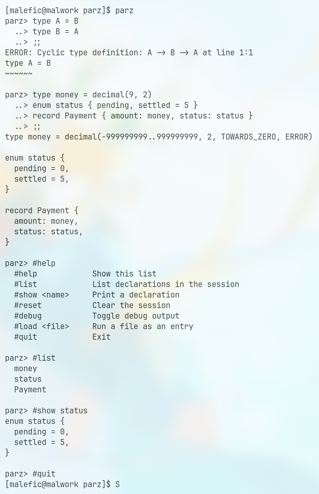

= parz

image:https://github.com/OmyDaGreat/parz/actions/workflows/gradle.yml/badge.svg[Gradle Build]
image:https://github.com/OmyDaGreat/parz/actions/workflows/publish.yml/badge.svg[Publish]
image:https://img.shields.io/maven-central/v/xyz.malefic.parz/bom[Maven Central Version]
image:https://img.shields.io/scoop/v/parz?bucket=https%3A%2F%2Fgithub.com%2FOmyDaGreat%2FMaleficBucket[Scoop Version]

A shared intermediate representation (IR) and interface definition language (IDL) for programming languages.

== Overview

parz aims to let different languages be translated into each other and, more importantly, be run side by side safely.

=== Current Features

An IDL system, implemented through a Kotlin model and a text format with parsing and verification.

A CLI program, serving as a schema checking tool for the IDL system and packaged through Scoop and Homebrew.

[source]
----
type Money = decimal(9, 2, round_half_to_even)
record Payment { id: decimal(18, 0), amount: Money, status: Status }
enum Status { pending, settled = 5 }
variant Result { ok(payment: Payment), rejected(reason: string(200)) }
----

=== Goals

A generic IR defined through the IDL, wide enough that any language can use it but narrow enough that it supports really old languages (possibly using scoped compilers to lock out new features).

A large set of frontends and backends for programming languages.

A verification tool that tests edge cases of the IDL and code equivalence while using the compilers. Also allows translation, including non-deterministic translation with AI, to be verified extremely easily.

== Usage

=== Libraries
* Get from Maven Central:

[source,kotlin]
----
implementation(platform("xyz.malefic.parz:bom:<version>"))
implementation("xyz.malefic.parz:idl-model")  // types, values and schemas
implementation("xyz.malefic.parz:idl-syntax") // the schema text format
implementation("xyz.malefic.parz:core") // diagnostics management
----

NOTE: All currently published libraries support JVM, Android, iOS, & js through Kotlin Multiplatform

It's recommended to use the BOM for version alignment. See the https://github.com/OmyDaGreat/parz/releases[Releases] page for the latest version, assigned either to the BOM or directly to each package.

Currently, you can describe your types through the IDL and check values against them.

* Create a compiler converting your language's typedefs into the link:idl/model/src/commonMain/kotlin/Type.kt[Type.kt] types.
* Declare records, variants and aliases in a link:idl/model/src/commonMain/kotlin/Schema.kt[Schema].
* Parse schema text with `parseSource(source)` from `idl-syntax`, which returns the syntax tree for the schema.
** Refer to link:tooling/cli/src/main/kotlin/[tooling/cli] for a basic implementation of a schema parser (specifically for text-based implementations).

=== CLI
The CLI tool can be obtained through a package manager:

[source, shell]
----
# Homebrew (mac & linux)
brew install OmyDaGreat/malefic/parz

# Scoop (windows)
scoop bucket add malefic https://github.com/OmyDaGreat/MaleficBucket
scoop install parz
----

NOTE: Make sure you have the package manager installed first! You can install it through https://brew.sh/[Homebrew] or https://scoop.sh/[Scoop].
If you don't want to use a package manager, you can also install the packages from the https://github.com/OmyDaGreat/parz/releases[Releases] page.

If you run the program with a file, it prints the output of running that file as if it were input.

[source,shell]
----
parz < payment.idl
----

Run it without input to type schemas in directly. End each one with `;;` to parse it:

[source]
----
[user@pc ~] parz
parz> type money = decimal(9, 2)
  ..> record Payment { amount: money, status: status }
  ..> enum status { pending, settled = 5 };;
----

Line editing and history (kept in `~/.parz_history`) are built in.

As you could probably tell, the inspiration for the tooling cli came from OCaml's UTop. However, this implementation only supports types and not values for now (as the IR has not yet been created).

Here's an example run:

== License

This project is licensed under the GNU AGPLv3. View the link:LICENSE[LICENSE] file for more information.

== Contributing

1. Fork the repository
2. Create a feature branch
3. Use https://github.com/OmyDaGreat/Kommit[Kommit] to write commit messages (for consistency)
4. Make your changes
5. Add tests for new functionality, with one file per feature
6. Submit a pull request

== Resources

* https://kotlinlang.org/docs/multiplatform.html[Kotlin Multiplatform Documentation]
* https://central.sonatype.org/[Maven Central Portal]
* https://vanniktech.github.io/gradle-maven-publish-plugin/[Vanniktech Maven Publish Plugin]
* https://github.com/ionspin/kotlin-multiplatform-bignum[Kotlin Multiplatform BigNum]
