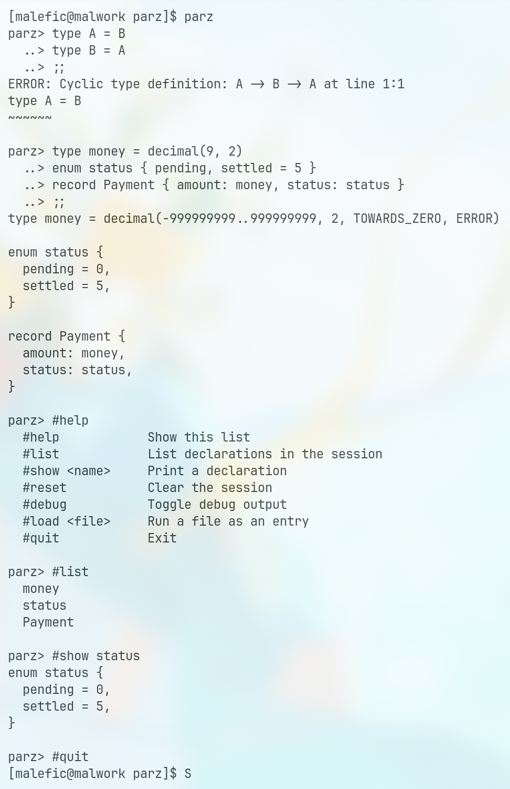

= parz CLI

The `parz` CLI checks schemas interactively, in the style of OCaml's UTop.
Schemas are written in link:../../idl/syntax/Spec.adoc[schema syntax], and checked against link:../../idl/model/Spec.adoc[the model's rules].
For now it only handles types, not values.

== Running
[cols="1,3"]
|===
|invocation |behavior

|`parz`
|from a terminal, starts an interactive session with line editing and history (kept in `~/.parz_history`)

|`parz < payment.idl`
|with piped input, runs every entry in the input as if it were typed, then exits

|`--debug`, `-d`
|starts with debug output on (see `#debug`)
|===

== Entries
Input is split into entries, each of which is either a directive or schema text.

* An entry ends with `;;`, so one entry can span many lines
* A line starting with `#` at the start of an entry is a directive, and ends right away without `;;`
* With piped input, any text left after the last `;;` is run as a final entry
* In a terminal, Ctrl+C discards the current input and Ctrl+D exits

Each schema entry is checked together with the declarations already in the session.
Diagnostics are printed first, then the accepted declarations, pretty-printed.

[source]
----
parz> type Money = decimal(9, 2)
  ..> record Payment { amount: Money, status: Status }
  ..> enum Status { pending, settled = 5 };;
----

== Directives
[cols="1,3"]
|===
|directive |function

|`#help`
|show this list

|`#list`
|list declarations in the session

|`#show <name>`
|show the value of a declaration

|`#reset`
|clear the session

|`#debug`
|toggle debug output, which prints the raw syntax tree instead of pretty-printed schema text

|`#load <file>`
|run a file as an entry

|`#quit`
|exit
|===

== Example Run

